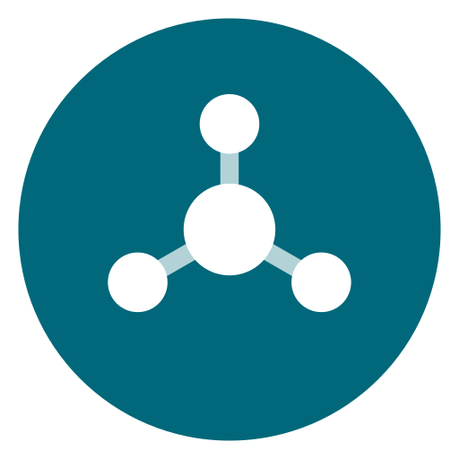
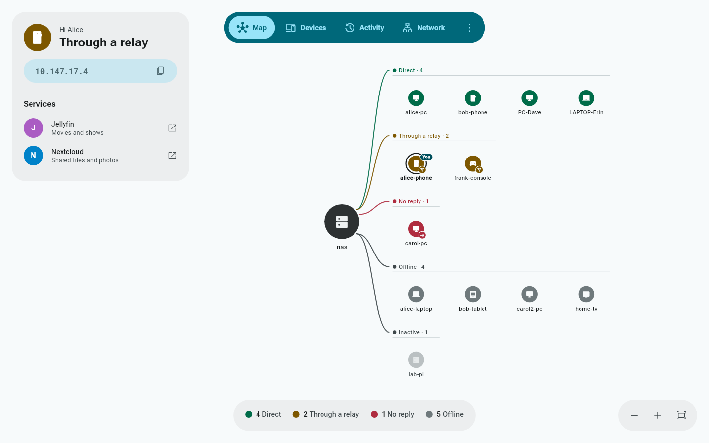
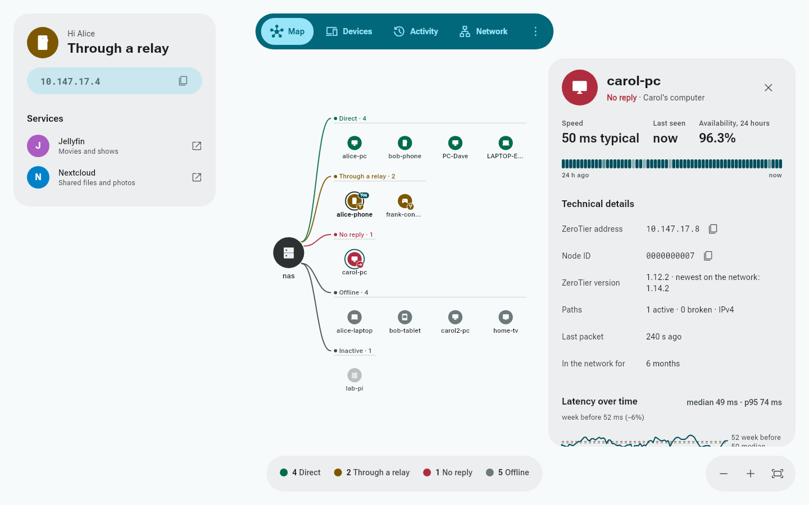
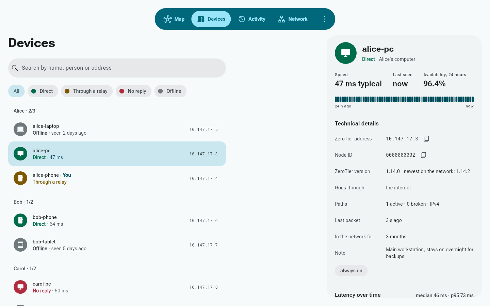
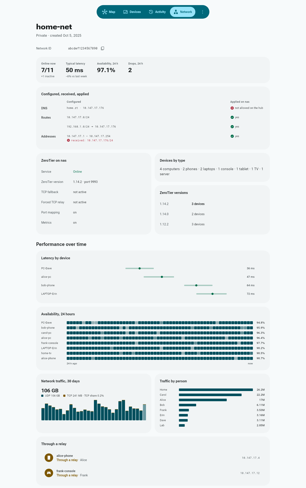
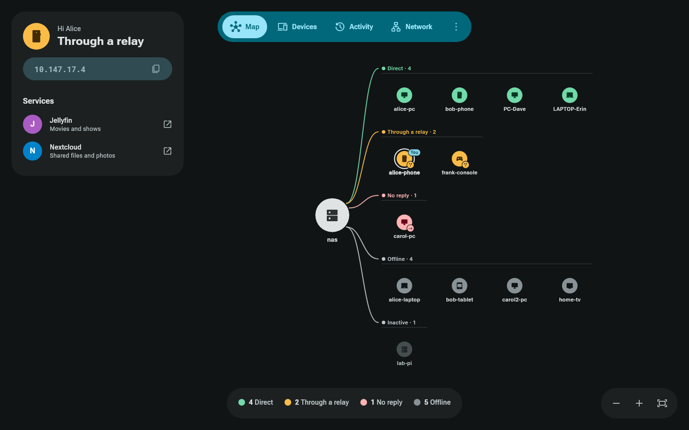
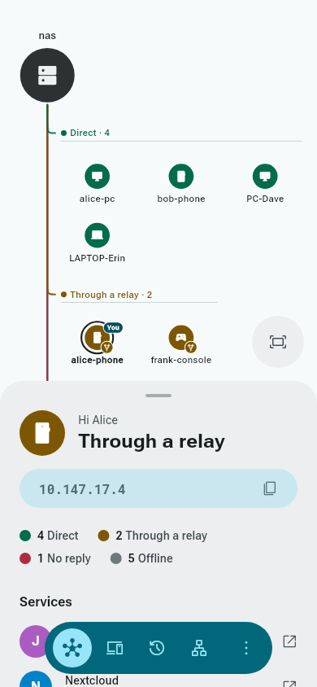
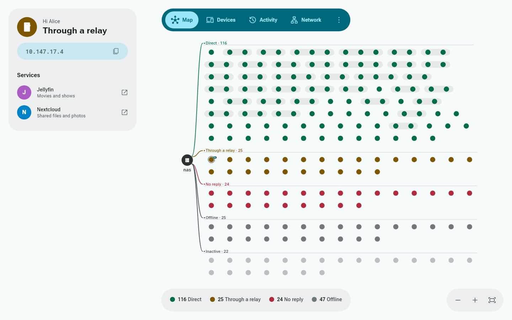

# Netmap

#### A live map and dashboard for your ZeroTier network.

[](https://github.com/ales-drnz/netmap/releases)
[](LICENSE)
[](https://ztnet.network)
[](#installation)
[](app)
[](https://github.com/ales-drnz/netmap)
[](https://discord.gg/g2Qf4Mq9MP)
[](https://www.patreon.com/cw/ales_drnz)
[](https://www.buymeacoffee.com/ales.drnz)

<table>
<tr>
<td valign="middle" width="90"></td>
<td valign="middle"><code>netmap</code> is a read-only web page for the members of a private ZeroTier network managed with <a href="https://ztnet.network">ZTNET</a>. It shows <b>who is connected, how, and how well</b>: a map of every device around the hub, direct or relayed links with their latency, 24-hour availability, what changed and when, and the services you can reach inside the network. The ZTNET token never leaves the server, and nobody's public IP ever reaches the browser.</td>
</tr>
</table>

---

## Installation

Netmap runs next to ZeroTier and ZTNET, sharing the ZeroTier container's network: it is reachable **only** from inside the ZeroTier network, and no port is published on the host.

```yaml
services:
  netmap:
    image: ghcr.io/ales-drnz/netmap:latest   # or :0.1 to stay on 0.1.x, or :0.1.0 for exactly that release
    container_name: netmap
    restart: always
    network_mode: service:zerotier
    depends_on:
      - zerotier
      - ztnet
    volumes:
      - zerotier:/var/lib/zerotier-one:ro   # latency, client version, path type
      - netmap_data:/data                   # history: uptime and charts survive restarts
    environment:
      - ZTNET_URL=http://ztnet:3000
      - ZTNET_API_TOKEN=your-ztnet-api-token
      - ZTNET_NETWORK_ID=your-16-char-network-id
      - HUB_NODE_NAME=nas                   # the member drawn at the centre of the map

volumes:
  netmap_data:
```

The ZeroTier token is read automatically from the mounted volume. ZeroTier keeps it root-only, so Netmap starts as root only to read it, then drops to uid 1000 before serving anything. If ZeroTier runs elsewhere, pass the token with `ZT_AUTHTOKEN`:

```sh
docker exec zerotier cat /var/lib/zerotier-one/authtoken.secret
```

Then open `http://<zerotier-ip-of-the-host>:8082` from any device in the network.

The ZTNET API token is created in ZTNET under *Account → API*. The network id is the 16-character hex string on the network's page.

## Requirements

| | Minimum | Notes |
| :--- | :--- | :--- |
| **ZTNET** | any version with the REST API | the member list and the network config come from it |
| **ZeroTier** | 1.12 | the local service gives latency, paths and client versions; optional but recommended |
| **Docker** | amd64 or arm64 | or Node.js 22+ to run the bundle directly |
| **Browser** | any evergreen browser with WebGL 2 | WebAssembly where supported (Chrome, Edge), JavaScript elsewhere, chosen on its own. No internet needed: engine, fonts and icons are bundled |

---

## Contents

* [Visuals](#visuals)
* [Features](#features)
* [Quick start](#quick-start)
* [Guide](#guide)
  <details>
  <summary><a href="#1-configuration"><b>1. Configuration</b></a></summary>

  * [1.1 Environment variables](#11-environment-variables)
  * [1.2 Services](#12-services)
  * [1.3 Naming devices](#13-naming-devices)

  </details>

  <details>
  <summary><a href="#2-what-it-reads"><b>2. What it reads</b></a></summary>

  * [2.1 From ZTNET](#21-from-ztnet)
  * [2.2 From the local ZeroTier service](#22-from-the-local-zerotier-service)
  * [2.3 Traffic metrics](#23-traffic-metrics)

  </details>

  <details>
  <summary><a href="#3-history-and-events"><b>3. History and events</b></a></summary>
  </details>

  <details>
  <summary><a href="#4-privacy"><b>4. Privacy</b></a></summary>
  </details>

  <details>
  <summary><a href="#5-development"><b>5. Development</b></a></summary>
  </details>

* [Licence](#licence)

---

## Visuals

#### The map: you, the hub, and a lane for every state

<p align="center">
  
</p>

#### A device, in plain words

<p align="center">
  
</p>

#### Every device and its technical details

<p align="center">
  
</p>

#### Latency, traffic and availability over time

<p align="center">
  
</p>

#### Dark theme

<p align="center">
  
</p>

#### On a phone

<p align="center">
  
</p>

#### A big network, from afar: every device in its state's lane, each person's together

<p align="center">
  
</p>

---

## Features

<table>
<tr>
<td valign="middle" width="48"></td>
<td valign="middle" width="45%"><b>A map of the network</b><br>the hub and one lane per state (direct, online, relay, no reply, offline, inactive), each person's devices together under their name.</td>
<td valign="middle" width="48"></td>
<td valign="middle" width="45%"><b>Live</b><br>a new snapshot is pushed to every open page after each poll, over Server-Sent Events.</td>
</tr>
<tr>
<td valign="middle"></td>
<td valign="middle"><b>Latency that means something</b><br>median, 95th percentile and jitter, and each device compared with itself the week before.</td>
<td valign="middle"></td>
<td valign="middle"><b>Plain words first</b><br>"Online", "through a relay": the state first, then latency, IPs and versions right under it, nothing hidden.</td>
</tr>
<tr>
<td valign="middle"></td>
<td valign="middle"><b>Configured, received, applied</b><br>DNS, routes and addresses followed from the controller to the hub, so you see where the chain breaks.</td>
<td valign="middle"></td>
<td valign="middle"><b>What changed</b><br>disconnections, path changes and latency spikes; three devices dropping together are one incident, not three.</td>
</tr>
<tr>
<td valign="middle"></td>
<td valign="middle"><b>Services directory</b><br>what you can reach inside the network, how to connect, and whether it answers right now.</td>
<td valign="middle"></td>
<td valign="middle"><b>Read-only by design</b><br>everyone in the network can open it; authorizing members stays in ZTNET.</td>
</tr>
<tr>
<td valign="middle"></td>
<td valign="middle"><b>Private where it matters</b><br>public IPs are used on the server to tell LAN from internet, and never sent to the browser.</td>
<td valign="middle"></td>
<td valign="middle"><b>One file to run</b><br>the server is a single bundle with no <code>node_modules</code>; the image is amd64 and arm64.</td>
</tr>
<tr>
<td valign="middle"></td>
<td valign="middle"><b>Readable by everyone</b><br>every state has a colour, an icon and a word, never colour alone; AA contrast in both themes, keyboard and screen reader friendly, and nothing that moves.</td>
<td valign="middle"></td>
<td valign="middle"><b>English and Italian</b><br>one word per concept in both languages, light, dark or system theme, and a layout made for desktop and for phones.</td>
</tr>
</table>

---

## Quick start

Try it without a ZeroTier network: the mock starts a fake ZTNET and a fake ZeroTier service with demo data. Building the web app needs [Flutter](https://docs.flutter.dev/get-started) 3.47 or newer.

```bash
git clone https://github.com/ales-drnz/netmap.git
cd netmap
npm install
npm run build:web
npm run dev
```

Open `http://localhost:8082`. `npx tsx mock/dev.ts 50` adds fifty more devices.

---

## Guide

### 1. Configuration

#### 1.1 Environment variables

| Variable | Default | Description |
| :--- | :--- | :--- |
| `ZTNET_URL` | `http://ztnet:3000` | ZTNET address, from inside the Docker network |
| `ZTNET_API_TOKEN` | — | **required**. Stays on the server |
| `ZTNET_NETWORK_ID` | — | **required**. The 16-character network id |
| `HUB_NODE_NAME` | — | name or address of the member drawn at the centre, usually the host. Without it, the centre is the network itself |
| `ZT_SERVICE_URL` | `http://127.0.0.1:9993` | local ZeroTier service. Reads the token from the mounted `zerotier` volume |
| `ZT_AUTHTOKEN` | — | ZeroTier service token, if the volume is not mounted. Wins over the file |
| `ZT_AUTHTOKEN_FILE` | `/var/lib/zerotier-one/authtoken.secret` | where the token is read from |
| `NETMAP_UID` / `NETMAP_GID` | `1000` | user and group Netmap drops to after reading the token as root. `NETMAP_KEEP_ROOT=1` stays root |
| `SERVICES_FILE` | `services.json` next to the server | services shown in the home panel, opened with a tap, see [1.2](#12-services) |
| `QUICK_LINKS` | — | quick alternative to `services.json`: `Name=URL,Name=URL` |
| `SHOW_OFFLINE` | `true` | `false` hides offline devices; they are not even sent to the browser |
| `POLL_SECONDS` | `20` | how often ZTNET is polled (minimum 5) |
| `SPIKE_MS` | `150` | a latency above this, and at least three times the recent median, is a spike |
| `ONLINE_WINDOW_MINUTES` | `5` | "seen within N minutes" means online, when ZTNET gives no status |
| `HISTORY_FILE` | `/data/history.json` | where history is saved. If the folder is not writable, history stays in memory |
| `SAVE_SECONDS` | `120` | how often history is saved (minimum 30); also saved on shutdown |
| `PORT` | `8082` | listening port, inside the ZeroTier container's network |
| `BIND_HOST` | `0.0.0.0` | listening address |

#### 1.2 Services

Mount a `services.json` (see [`services.example.json`](services.example.json)) at `/app/services.json`:

```json
[
  {
    "name": "Jellyfin",
    "url": "http://10.147.17.10:8096",
    "description": "Movies and shows",
    "app": "Jellyfin for iOS, Android and TV",
    "host": "nas",
    "color": "#aa5cc3"
  }
]
```

Only `name` and `url` are required. `host` is the member that runs the service, so the page can say a service is down because its host is offline. On every poll the server opens a TCP connection to each configured address, and to nothing else: the page says whether the service **answers**, not whether it works for you.

**Icons.** Netmap shows each service with its own icon, found by the server: it reads the icon the service's page declares (`<link rel="icon">`, `apple-touch-icon`), or `/favicon.ico`, and serves it from Netmap itself, so the browser never contacts the service for it. The search stays on the configured address (same scheme, host and port; redirects only within it), accepts only PNG, ICO, JPEG, GIF or WebP up to 256 KB (no SVG), and runs at most once a day per service. Without an icon the page shows the service's initial in `color`. To choose the icon yourself, add `"icon"`: an `http(s)` URL, or an image file next to `services.json` (for example `"icon": "icons/jellyfin.png"`).

#### 1.3 Naming devices

Owner and device type come from the member name. The suggested convention is `person-type[-qualifier]`, all lowercase: `alice-pc`, `alice-phone-work`, `bob-tablet`, `home-tv`, `carol-pc-2`.

The type is recognised anywhere in the name, so `PC-Dave` and `LAPTOP-Erin` work too. The owner is the first part that is not a type, and trailing digits are ignored when grouping (`carol2-pc` joins `carol`). Recognised types and synonyms:

| Type | Words |
| :--- | :--- |
| PC | pc, desktop, computer, workstation, imac |
| Laptop | laptop, notebook, macbook |
| Phone | phone, iphone, android, smartphone, pixel, galaxy |
| Tablet | tablet, ipad |
| TV | tv, chromecast, firestick, appletv, shield |
| Server | server, nas, controller, pi, raspberry, vm, proxmox |
| Console | console, ps5, xbox, switch, steamdeck |
| Other | iot, cam, printer, sensor |

On the map, in each state's lane, a person's devices sit together; two or more get their owner's name above them.

### 2. What it reads

#### 2.1 From ZTNET

The member list (name, addresses, authorization, last seen), the network configuration (routes, DNS, address pools, MTU, privacy) and the notes and labels you wrote on members. Members waiting for authorization are listed as **access requests**, separately from devices: Netmap never authorizes anyone, that stays in ZTNET.

#### 2.2 From the local ZeroTier service

With the `zerotier` volume mounted, `GET /peer`, `/status` and `/network` give:

- **latency** and **path type**: `lan` (same physical network), `wan` (direct over the internet) or `relay` (no direct path). ZTNET's REST API has no connection status, so without the local service relay and direct are unknown;
- **client version**, compared across the network: Netmap never calls a version "outdated", it says "someone in the network runs 1.14.2";
- **half-open paths**: we keep sending, the device has stopped answering;
- **active paths** and the address family;
- **service health**: TCP fallback in progress, forced TCP relay, port mapping off;
- **what reached the hub**: the network as the hub received it, to compare with what the controller configured.

ZeroTier roots (`PLANET`, `MOON`) are not devices and are ignored.

#### 2.3 Traffic metrics

ZeroTier counts **packets** per device, not bytes, and Netmap calls them packets. Bytes exist for the whole node, split by UDP and TCP: traffic over TCP gave up on the direct path, so its share is a health signal.

Metrics are off by default since ZeroTier 1.16.1. Enable them in `/var/lib/zerotier-one/local.conf` of the ZeroTier container and restart it:

```json
{ "settings": { "enableMetrics": true } }
```

ZeroTier's counters live in memory and reset on restart; Netmap stores daily deltas, so the 30-day charts fill up from the day you enable them.

### 3. History and events

History is kept in memory and saved to `HISTORY_FILE` atomically (temporary file, then rename), and on shutdown. It holds:

- the last 90 latency samples per device, for the sparklines;
- 24 hours of availability in 60 buckets of 24 minutes;
- a 30-day latency histogram per device, so the median and 95th percentile can be compared with the previous week;
- the latest events.

Events come from comparing each poll with the previous one: disconnections, reconnections, direct ↔ relay changes, latency spikes (only on the rising edge) and access requests. Three or more devices dropping in the same poll become a single incident, because it is one problem, usually the hub's connection.

Until history fills up, empty slots stay empty: the page never shows data it does not have.

### 4. Privacy

Everyone in the network can open the page, so:

- the **ZTNET token** stays on the server; the browser only talks to Netmap;
- **public IP addresses** of devices (`paths[].address`, `surfaceAddresses`) are used on the server to tell LAN from internet and are never sent to the browser: they reveal where someone connects from;
- the page is **read-only**: no action in it changes the network.

Every member does see the names and ZeroTier addresses of the other authorized members.

### 5. Development

```text
server/src   TypeScript server: sources/ (ZTNET, ZeroTier), history/, snapshot.ts, http.ts
app/         Flutter web app (Material 3 Expressive), English and Italian
  lib/data     the API contract in Dart (mirrors shared/api.ts), live updates, the logic
  lib/map      the constellation map: layout and drawing
  lib/pages    home, devices, activity, network
  lib/l10n     translations and the glossary (GLOSSARY.md)
shared/      the API contract (TypeScript), the server's source of truth
mock/        fake ZTNET and ZeroTier service for development and tests
```

```bash
npm run dev          # mock network + server on :8082 (serves app/build/web)
npm run dev:web      # the app with hot reload on :8083, API proxied to :8082
npm test             # server: unit and end-to-end tests
npm run test:app     # app: unit, widget, accessibility and golden tests
npm run check        # types (server) and flutter analyze (app)
npm run lint
npm run build        # dist/server.mjs + dist/web
```

The app is built with `flutter build web --wasm --no-web-resources-cdn` (see `scripts/build-web.mjs`): the browser gets WebAssembly where it can and JavaScript otherwise, and nothing is loaded from a CDN. Live data comes from `/api/stream` (Server-Sent Events), with `/api/nodes` polling as fallback.

The screenshots above are drawn by the app itself in `app/test/readme`: after a visual change, `cd app && flutter test --update-goldens test/readme test/goldens` refreshes them and the golden tests.

`node dist/server.mjs` runs the build anywhere with Node.js 22+. The Docker image is built by GitHub Actions on every push to `main` (`:latest`).

**Releases** follow [Semantic Versioning](https://semver.org) and are listed in the [changelog](CHANGELOG.md). To publish one: set the version in `package.json` (`npm version X.Y.Z --no-git-tag-version`), add a section for it at the top of the changelog, commit, then push a `vX.Y.Z` tag: CI builds the `X.Y.Z` and `X.Y` images. The running version is shown in the app's `⋮` menu.

---

## Licence

The project is **BSD 3-Clause**, in [LICENSE](LICENSE). Bundled fonts: Roboto Flex and Roboto Mono, under the **SIL Open Font License 1.1** (`app/assets/fonts`), and Material Symbols, under the **Apache License 2.0**. Flutter and its packages keep their own licences, listed in the app's `assets/NOTICES`.

---

*Developed by Alessandro Di Ronza*
